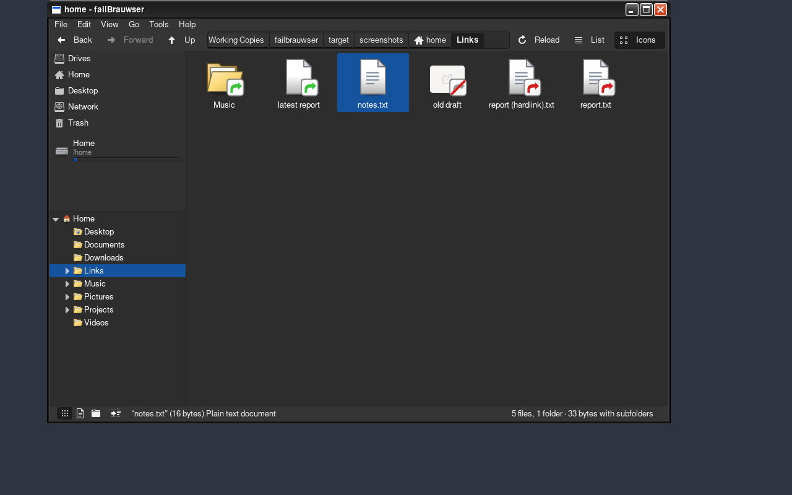
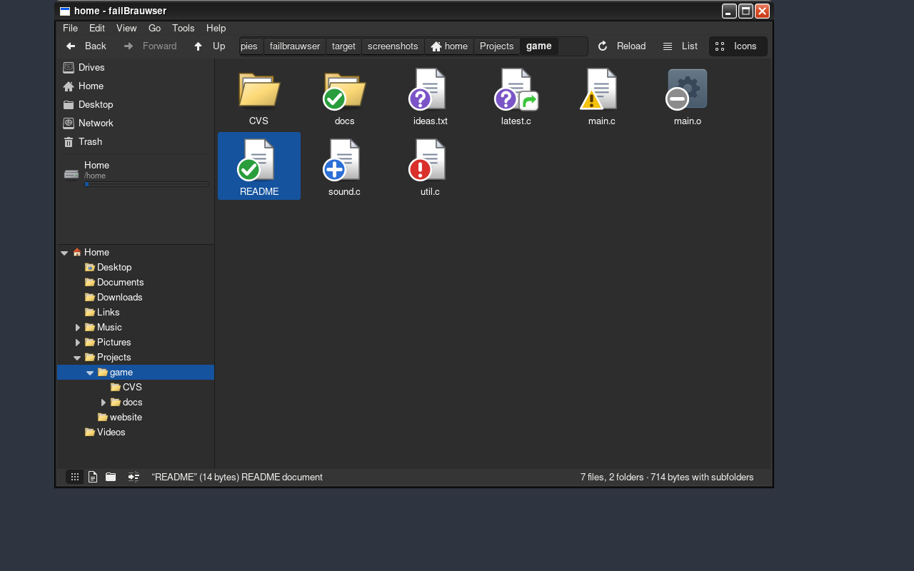

# failBrauwser

A fast, native GTK 3 file manager for Linux and Windows, in the spirit of Thunar — that opens archives like folders.


- **Fast copies.** Reflinks where the filesystem can, in-kernel `copy_file_range` otherwise,
  and many small files copied in parallel. Writes to USB sticks and spinning disks are paced,
  so the system never stalls behind gigabytes of cached data and unmounting is instant.
- **Archives are folders.** Enter a `.zip`, `.7z`, `.tar.gz`, a disk image or any of the
  ~580 formats the archive library knows, even an archive inside an archive, and copy, paste,
  rename, delete or create files in it like anywhere else. Open a file from inside an archive,
  edit it, save — the archive is updated. *Compress…* writes about 420 of these formats.
- **Looks like your desktop.** Native GTK widgets and your GTK theme, icon theme and fonts;
  nothing is custom-drawn; the right-click menus show your icon theme's icons. Switching the
  desktop between light and dark mode restyles every window at once.
- **Opens instantly.** After the first start a background instance keeps running; a new
  window appears ~40 ms after you click the launcher, using no CPU while idle.
- **Drives in the side panel** with a fill bar under each mount point; the system's own
  partitions (`/boot`, EFI, `/` when home has its own) stay out of the way.
- **Drives page** with every volume, its fill level and mount point; mount, unmount and eject
  without freezing the window, and a properties window per drive (UUID, partition, model,
  serial, SSD or HDD, mount options, …).
- **Network page** with the computers sharing folders on your network, by name and with their
  folders; a double click shows the folders one shares, entering a folder asks for a password where the server wants one, and
  computers and folders pin to the side panel.
- **Phones and cameras** next to the USB sticks under their own name (“Pixel 7”), one row per
  storage with its fill level; open and eject them there, and a locked phone tells you what
  to tap.
- **Links on the desktop** from the right-click menu of files, folders, side panel entries,
  drives (in the side panel and on the drives page) and the folder tree: standard `.desktop` links every desktop understands.
- **Links the way Link Shell Extension makes them.** Drag with the right mouse button and drop:
  *Move here*, *Copy here*, *Create Archive here…*, *Create Link here* (symbolic link, hard link,
  junction, shell link — what the target's filesystem can hold) and *Drop As* Smart Copy, Smart
  Mirror, DeLorean Copy, Hardlink Clone and Symbolic Link Clone. Overlay icons mark hard links,
  junctions and symbolic links; folders moved keep the links inside them pointing right.
- **Trash shared with Thunar** and other file managers (freedesktop.org spec): browse it,
  restore to the original place, delete permanently, empty.
- **Thumbnails** for pictures, videos and documents (shared with other file managers), and
  zoom from tiny rows to big icons with <kbd>Ctrl</kbd>+scroll.
- **Search** (<kbd>Ctrl</kbd>+<kbd>F</kbd>) through subfolders and even inside archives, with
  results streaming in.
- **Copy jobs you control:** a progress window with a speed chart in the window manager's
  theme, the time and items left; pause and resume, copies to the same drive wait in a queue instead
  of fighting each other, optional read-back verification, and a copy or move cut off by a crash or
  an update going on exactly where it stopped.
- **Custom actions** from Thunar (`uca.xml`) in the right-click menu, and *Open Terminal Here*.
- **Version control the TortoiseGit way, for Git, Mercurial, Subversion, CVS and Visual
  Source Safe.** Overlay icons on the files and folders of working copies (a green tick, a red
  exclamation mark, a blue plus, …), *Git Sync…* / *SVN Update*, *Commit -> "main"…* and the
  *Repository* submenu in the right-click menu, and TortoiseGit's dialogs: Commit, Log Messages
  with the revision graph, side-by-side diffs, Blame, Pull, Push, Switch, Merge, Resolve, Revert
  and more. Off until switched on in *Edit → Version Control Integration*.
- **More details.** Folder sizes in the *Size* column (recursive, symlink-safe), a
  configurable column set, shortcuts and a folder tree rooted at the current folder, your home
  or `/`.

## Screenshots

| Inside a zip | Archive inside an archive |
|---|---|
|  |  |

| Drives | Icon view |
|---|---|
|  |  |

| Properties | Copy conflict |
|---|---|
|  |  |

| Trash | Drive properties |
|---|---|
|  |  |

| Search |  |
|---|---|
|  |  |

The screenshots are generated by `scripts/screenshots.sh` in a headless compositor with the
current desktop theme (here: Adwaita dark with Breeze colors and a Windows XP icon theme).

## Install

```sh
./install.sh                # for your user, into ~/.local
./install.sh --system       # for everyone, into /usr/local (uses sudo)
./install.sh --default      # …and make it the default file manager
./install.sh --uninstall    # remove it again (same options as for installing)
./install.sh --deps-only    # only set up what building needs
```

The script builds everything, installs the program, the archive helper, a launcher and the icon,
and registers a background instance that starts with your session (`--no-autostart` to skip
that; windows then take a moment longer the first time).

failBrauwser's own icon is a **blue folder** with a paper sheet, a zipper and a speed bolt
(`data/icons/org.failbrauwser.FailBrauwser.svg`). It is the window icon everywhere, and on
Windows the same picture is compiled into both program files (`data\icons\failbrauwser.ico`,
rendered from the svg by `winpack\mkico.ps1`), so Explorer, the Start Menu entry and the
titlebar all carry it; the packaged tree also ships the svg under
`share\icons\hicolor\scalable\apps\`, where GTK looks it up by application id. It also makes failBrauwser the open
and save dialog of applications that ask the desktop portal for one (`--no-file-chooser` to
keep the desktop's; see *File chooser for other applications* below).

On Windows (PowerShell, in a checkout with the [toolchain below](#requirements) set up):

```powershell
winpack\package.ps1           # build release and pack failbrauwser-<version>-x86_64-windows.zip
winpack\install.ps1           # install it for your user (default %LOCALAPPDATA%\Programs)
winpack\install.ps1 -Prefix D:\Apps\failBrauwser
```

`package.ps1` also builds `failbrauwser-<version>-x86_64-windows.exe`: the whole application
as one file — run it once and it unpacks itself into your Programs folder and starts; that
single file is all that folder needs (see [docs/WINDOWS.md](docs/WINDOWS.md)). An unpack that
cannot be applied — a copy that stays open after being asked to close, still holding that folder's
program file — leaves your installed copy untouched and says why in a window, naming the process that
holds it, rather than doing nothing quietly.

Starting failBrauwser on Windows never opens a console window: the program file is linked as
a windowed program, so a double-click, the Start Menu entry and the single-file launcher each
show only failBrauwser's own window. Started from a terminal it still answers `--help`,
`--version` and `--quit` in that terminal, and the archive helper it starts runs without a
window of its own and ends together with the instance that started it. The same holds for every
program it starts in the background — a version-control client, `curl`, the update's swap script —
and where a window is the point (a terminal asked for, the administrator's password) it does
appear: [docs/TOOL-STARTS.md](docs/TOOL-STARTS.md) lists every start, on both systems, and what
bounds it.

`winpack\bootstrap.ps1` fetches the pinned GTK stack (list in `winpack\packages.txt`) into
`winpack\sysroot` from the MSYS2 repository named in `winpack\mirror.txt` — here the company
Artifactory's mirror of `repo.msys2.org`; point it at any reachable MSYS2 tree — and
`winpack\genimports.ps1` makes its MSVC import libraries; `winpack\build.ps1 -Release` is the
plain build without packaging. Uninstalling is deleting that folder and the Start Menu entry.
On Linux, `winpack/cross/setup.sh` and `winpack/cross/env.sh` build the same Windows program and
run its tests under Wine (docs/WINDOWS.md: *Building on Linux, testing under Wine*).
See [docs/WINDOWS.md](docs/WINDOWS.md) for the full picture of how the two systems line up.

### Updating

*Help → Check for Updates* says whether GitHub has a newer release and installs either the
newest **release** — its ready-built package (`failbrauwser-<version>-<arch>-linux.tar.gz`,
installed with `install.sh --prebuilt`; on Windows `failbrauwser-<version>-x86_64-windows.zip`,
whose files replace the install folder once every copy of it has closed) — or builds the current
**source** (needs what a build needs, below; Linux only, since it runs `install.sh`). Both install into the same place with the options of the last install (kept in
`~/.config/failbrauwser/install-options`); the download, source included, is deleted when it is
done, and failBrauwser restarts as the new version. The window shows the installer's output
and a progress bar above it: while the source compiles it counts the crates done against the
crates the build needs (`install.sh` counts them with `cargo tree` and says
`Building failBrauwser: <n> crates`), "Compiling 123 of 310 crates"; steps of no known length
(downloading, setting up Rust, the archive helper, installing) pulse under their name. A
build that goes on from an earlier one is not counted; its bar pulses.

What a build makes is kept for the next one, in `~/.cache/failbrauwser`, which may be deleted
at any time. The **archive helper** is kept with a hash of its sources (the helper's, the
vendored library's and the Makefile): while they are unchanged, `install.sh` takes it as it is
and needs no .NET SDK, saving the minute or more its native compile takes. A source **outside
a git checkout** (a download, as updates build it) keeps its Rust build folder there too
(`build`, about 450 MB), so the next build compiles only what changed. Updates unpack the
source at the same place each time, so that build is reused instead of added to. A clean
build takes about 1½ minutes on 28 cores, an update of the program's own code about 20
seconds, and one that changed nothing a second. A git checkout builds into its own `target`
as before. A copy installed for everyone (`--system`) is updated from a terminal. `scripts/package.sh` and
`winpack\package.ps1` make the release packages.

**Updating with more than one copy open:** an update closes them all, and it asks rather than
reaches in. Each running copy keeps a record of what it was showing — every window with its folder,
its tabs, which tab stood in front and which entry was selected — in `failbrauwser\sessions\<process
id>` below the folder this program keeps its per-user state in (`~/.local/share/failbrauwser` on
Linux, `%LOCALAPPDATA%\failbrauwser` on Windows, and it survives an update because the update only
touches the install folder). Asked to close, a copy writes that record once more, cleans up what it
staged for itself, and closes by itself, which is why a window that was waiting for an answer closes
as if cancelled and a job that was running is left in the state *Resuming an interrupted operation*
describes. The ask is an ask: a copy that does not close in the time given is named by its process id
and the update stops there with nothing replaced, because nothing here ends a process it did not
start, and a copy held open by a modal dialog or a job says so in its own window instead of being
killed. Only when the last record is gone does the swap run — a script that belongs to no window, on
Windows as on Linux, since it outlives the program whose files it replaces — and the new version is
started with those records handed to it, so every window comes back where it was. A remembered folder
that no longer exists (an unplugged stick, a removed folder) opens at the nearest folder that does and
says what it could not open. A record whose process no longer runs and whose windows nobody restored
is a leftover, and the next start clears it; a record that lies about itself restores nothing and is
reported, never obeyed. The single-file launcher obeys the same rule where it only refused: it asks
the copies it finds running, waits for them, and installs only once nothing holds the folder; a copy
that stays open leaves the refusal standing and names the process holding it.

### Requirements

- Rust 1.92 or newer, GTK 3.24 (development files), `pkg-config`, a C compiler. Where the
  system's Rust is older, `install.sh` sets up a newer one with rustup in
  `~/.local/share/failbrauwser/rust`, used only for building (the system's stays as it is).
- For archives: the .NET 10 SDK and clang or gcc (the archive library is included in
  `vendor/`). `install.sh` downloads the SDK into `~/.local/share/failbrauwser/dotnet` when
  none is on the `PATH` (needs `curl` or `wget`); `--no-archives` skips archive support.
- Optional at run time: UDisks2 (drives page details and mounting), GVfs (trash, places;
  with its backends such as `gvfs-smb`, network addresses like `smb://host/share`; with
  `gvfs-mtp`, `gvfs-gphoto2` or `gvfs-afc`, Android phones, cameras and iPhones).

### Debian 13 and Ubuntu

`./install.sh` works as it is: it installs the packages a build needs that are missing
(`build-essential pkg-config libgtk-3-dev`, `zlib1g-dev` for the archive helper, `curl` if
there is no downloader) with `sudo apt-get`, and because Debian 13's Rust is 1.85, it sets up a
current one with rustup as above (a few hundred MB, downloaded once). The packages for
everything else, all optional:

```sh
sudo apt install udisks2 gvfs-backends gvfs-fuse smbclient pkexec lvm2
```

UDisks2 mounts drives below `/media/<you>/` on Debian, and failBrauwser's LVM volumes go there
too. `pkexec` (asked for the administrator password when opening LVM volumes) is its own
package on Debian 13. A ready-built release package needs a C library as new as the system it
was built on; where it does not run, *Check for Updates* says so and building from the source
works.

## Using it

| Keys | Action |
|---|---|
| <kbd>Ctrl</kbd>+<kbd>N</kbd> / <kbd>Ctrl</kbd>+<kbd>T</kbd> | New window / tab |
| <kbd>Alt</kbd>+<kbd>←</kbd> <kbd>→</kbd> <kbd>↑</kbd>, <kbd>Backspace</kbd>, the mouse's back/forward keys | Back, forward, up |
| <kbd>Alt</kbd>+<kbd>Home</kbd> / <kbd>Alt</kbd>+<kbd>D</kbd> / <kbd>Alt</kbd>+<kbd>N</kbd> | Home / Drives / Network |
| <kbd>Ctrl</kbd>+<kbd>L</kbd> | Type a location (also paths through archives: `~/a.zip/docs`) |
| <kbd>Ctrl</kbd>+<kbd>C</kbd> <kbd>X</kbd> <kbd>V</kbd> | Copy, cut, paste (works with other file managers too) |
| <kbd>F2</kbd>, <kbd>Delete</kbd>, <kbd>Shift</kbd>+<kbd>Delete</kbd> | Rename (several: batch rename), move to trash, delete |
| <kbd>Ctrl</kbd>+<kbd>Z</kbd> | Undo the last operation |
| <kbd>Ctrl</kbd>+<kbd>Shift</kbd>+<kbd>N</kbd> | New folder |
| <kbd>Ctrl</kbd>+<kbd>H</kbd> | Show hidden files |
| <kbd>Ctrl</kbd>+<kbd>1</kbd> / <kbd>Ctrl</kbd>+<kbd>2</kbd> | Detailed list / icons |
| <kbd>Ctrl</kbd>+<kbd>+</kbd> <kbd>-</kbd> <kbd>0</kbd>, <kbd>Ctrl</kbd>+scroll | Zoom in, out, normal size |
| <kbd>Ctrl</kbd>+<kbd>F</kbd> | Search |
| <kbd>F5</kbd>, <kbd>F9</kbd>, <kbd>Alt</kbd>+<kbd>Enter</kbd> | Reload, side panel, properties |

**Path bar:** every step of the path, from `/`, is a button; the folder you are in is shown
pressed, and the last step always stays in view. Click the empty space right of the last
button (the text cursor shows where; or press
<kbd>Ctrl</kbd>+<kbd>L</kbd>) to type a location; <kbd>Enter</kbd> or <kbd>Esc</kbd> returns to
the buttons. A network address (`smb://host/share`, `\\host\share`, `sftp://host/dir`, …) is
mounted through GVfs, asking for a password if needed, and opens as its local GVfs folder.
While you type one, the bar suggests addresses opened before, SMB servers found on the
local network (searched in the background, about two seconds) and, once a server is typed
with its slash, that server's shares. A path (`/…` or `~/…`) is completed as you type: the bar
lists the folders of the folder being typed in, and the archives that open as folders, matching
in any case; names starting with a dot show once you type the dot. Taking a folder goes on into
it, and **Tab** completes as far as the names agree, the whole name when only one fits. A
network share that does not answer is not waited for. Home and Drives are in the side panel.
**Servers by name:** *Add Server…* on the Network page keeps an SFTP, WebDAV (HTTPS or HTTP),
FTP or Windows server under a name of your choice (server, port, user and folder; the address
is shown as you type). They are listed below the computers; a double click mounts and opens
one (asking for a password where needed), and the right-click menu edits, removes, pins or
links them. They are kept in `~/.config/failbrauwser/servers`. WebDAV needs GVfs's WebDAV
backend (`gvfs-dnssd` on Arch, `gvfs-backends` on Debian and Ubuntu).
**SSH hosts:** for SFTP, *SSH host* lists the `Host` entries of `~/.ssh/config` (with its
`Include`s; patterns like `Host *` are left out). Picking one fills the form, and the line below
it says where OpenSSH really connects (`root@xenon.example.org:2222, through neon`). The address
names the host as the file does (`sftp://xenon_root/`), so OpenSSH applies everything the file
says about it: user, port, key, jump host. On Windows, whose SSH client does not read the file,
the form takes its host name, user and port instead. Or leave it at *None* and type server,
port and user; a password is asked for when the server wants one. An SSH server opens in the
folder it starts you in, your home folder there, and is mounted like a share: on the drives
page with its free space, and *Eject* disconnects it. GVfs speaks SFTP, which every OpenSSH
server offers; a server that only allows `scp` cannot be opened.

Network addresses also open from the command line (`failbrauwser smb://nas/share`) and from
other applications. Mounted shares (SMB, SFTP, FTP, WebDAV, NFS) are listed with the drives in
the side panel and on the drives page — "Music on nas", with a fill bar and free space where
the server tells them — and *Eject* disconnects them. When the computer wakes up from sleep,
the shares mounted before are checked: one that hangs is reconnected, one that sleep took
away is mounted again, and the tabs showing them are read again. Shares send no change notices: a share's view is read again as soon as a
copy, move, delete, rename or new folder ends, and every three seconds while its window is in
use, so changes made from another computer show up too.

**Network:** the *Network* entry of the side panel (<kbd>Alt</kbd>+<kbd>N</kbd>, *Go →
Network*) lists the computers sharing folders: the ones answering for SMB on the local network
(each address is asked, about two seconds; the search is kept for a minute, the button at the
top searches again), the ones GVfs announces (DNS-SD, WS-Discovery) and the servers of
addresses opened before. Each is listed under its name, from the network's DNS, the name it
announces itself under (mDNS, `nas.local`) or its Windows name (NetBIOS, `NAS`), with the
folders it shares below it. Each is asked for its folders as a guest first (`smbclient`), and
only the ones with folders are listed: a router or printer that answers SMB without sharing
anything stays out; a computer that wants a password before it lists anything stays in
("Folders behind a password"). Only computers are listed. A double click (or <kbd>Enter</kbd>) on
one shows the folders it shares (`network:///nas` in the location bar), asking for a user name
and password first if the server wants one; hidden shares (`IPC$`, `C$`) are left out.
Entering a folder mounts it through GVfs, with the password dialog where needed, and opens
it. Right-click a computer or a folder to open it in a new tab, *Pin to Side Panel* (it goes
below *Network* and opens with a click from there; rename, move or remove it like any
entry), create a link on the desktop or copy its address. Without GVfs's SMB support
(`gvfs-smb`) the folders are asked of `smbclient` as a guest.

**Shares that stop answering:** before a share is listed or copied to, failBrauwser asks it
with a timeout, so a server that went away (or a stuck GVfs) never freezes the window. The
folder then says the share is not responding and offers *Reconnect*, which mounts it again;
if GVfs itself is stuck, it offers to restart GVfs. Cancel always ends a copy onto a share
within a few seconds, and a copy that moves no data for a minute stops with an error.

Click empty space in the list to clear the selection (and to leave the typed path).
Right-click the files while their right-click menu is open to get the folder's menu instead
(*Show Hidden Files*, *Paste*, *Create Folder…*), as on Windows: handy when the folder is so
full that no empty space is left.
The status bar shows how many files and folders the current folder holds and how much space
it needs, subfolders included.

Drag and drop moves within a filesystem and copies across filesystems; hold
<kbd>Shift</kbd> to move, <kbd>Ctrl</kbd> to copy, both to link. In the list, dragging from a
file's icon or name drags it, and dragging from the empty part of a row draws a selection
rectangle; pressing one of several selected files drags them all, shown as a stack with their
count. Middle-click a folder to open it in a new tab.

Drag with the **right** mouse button and a menu opens where you drop — on the list, on a folder
in the folder tree or in another failBrauwser window — asking what to do (a right-button drag
from another file manager that asks opens it too):

| Item | Does |
|---|---|
| *Move here* / *Copy here* | what a plain drag does |
| *Create Archive here…* | the Compress window for what is dragged, the archive written into the folder dropped on |
| *Create Link here* ▸ | *Symbolic Link*, *Hard Link*, *Junction*, *Shell Link* — each only where it can be made (see Links) |
| *Drop As* ▸ | *Smart Copy*, *Smart Mirror*, *DeLorean Copy*, *Hardlink Clone*, *Symbolic Link Clone* (when folders are dragged) |
| *Cancel* | nothing |

A right click that does not move opens the right-click menu as before.

**Columns:** *View → Columns* or right-click a column header. For folders, *Size* shows
everything inside, added up on background threads (“…” until known, “≥” while counting);
sorting by size sorts folders by that total. Symbolic links are never followed (a link to `/`
would count the whole disk, link loops would never end), a folder met twice (a bind mount of a
folder inside itself) is counted once, hard-linked files count once, and mounted filesystems
below a folder are not entered. Folders on network shares are measured separately, so a slow
share does not hold up the others.

**Folder tree:** *View → Folder Tree → Tree Starts At* the current folder, your home folder or
`/`.

**Side panel entries:** Drives, Home, Desktop, Network, Trash, your folders, pinned network
places and the mounted volumes,
in the order you like. Right-click an entry to rename, move, hide or remove it (built-in
entries can only be hidden), or to eject a volume; right-click the empty space to add the
current folder or show a hidden entry again. Drag entries to reorder them, and drop folders
from the file list onto the panel to add them. Middle-click opens an entry in a new tab. The
first start takes over your GTK bookmarks; the arrangement is kept in
`~/.config/failbrauwser/shortcuts`. The mounted volumes there are network shares and the
like; drives and phones have their own list below.

**Drives in the side panel:** between the entries and the folder tree, every connected drive,
partition and phone that holds your files, each with the folder it is mounted on (or the
phone's storage) and a bar showing how full it is. The system's own partitions are left out:
`/boot`, the EFI partition, swap, `/usr`, `/var` and the like, and `/` when your home folder
is on a partition of its own (then that one shows, as *Home*). A volume without a label is
called after the folder it is mounted on (*Downloads* for one mounted on `~/Downloads`).
Drives that are not mounted are listed too (*Not mounted — click to mount*): click a drive to
open it, mounting it or connecting to the phone first; middle-click for a new tab, right-click
to unmount, eject or see its properties. An encrypted (LUKS) stick says *Encrypted — click to
unlock*: a click asks for its passphrase (again if it was wrong), unlocks and mounts it.
Unmounting or ejecting it locks it again, as other file managers do; the drives page has an
*Unlock* button for it. A disk with LVM volumes inside the encryption (a whole Linux
installation on a USB disk) opens too, also when its volume group has the same name as this
computer's (`ArchinstallVg` on both): after the passphrase failBrauwser asks for the
administrator password (polkit) and maps the volumes under names of its own, reading LVM's
data on the disk but never changing it, and mounts them below `/run/media/<you>/`
(`/media/<you>/` on Debian and Ubuntu, where UDisks2 mounts drives). Unmounting
one of them closes them all and locks the disk again. A drive plugged in moves the split down so the list fits; the bars
follow as drives fill up.

**Links on the desktop:** *Create Link on Desktop* in the right-click menu of files and
folders (on the empty space: the folder shown), of side panel entries, of drives and phones
in the side panel and on the drives page, and of folders in the tree. It writes a freedesktop.org Desktop Entry of type `Link` into your
desktop folder (`XDG_DESKTOP_DIR`, usually `~/Desktop`), e.g. `Music.desktop`:

```ini
[Desktop Entry]
Version=1.0
Type=Link
Name=Music
URL=file:///home/me/Music
Icon=folder-music
```

GNOME (with the Desktop Icons extension), KDE Plasma, Xfce, Cinnamon, MATE, LXQt and PCManFM
show it as an icon that opens the folder, file or drive. The file is marked executable, which
some desktops want before they trust it; a second link of the same name gets a number
(`Music (2).desktop`). A link to a phone that is not open points to its `mtp://` address.
The Drives entry has no address other programs know, so its link is an entry of type
`Application` that starts `failbrauwser drives:///` and opens the drives page.

**Links:** failBrauwser makes and shows links the way Hermann Schinagl's Link Shell Extension
(LSE) does on Windows; its documentation is the specification followed, item by item.

*What can be made where.* The *Create Link here* submenu offers only what the folder dropped on
can hold:

| Link | Made when | Linux | Windows |
|---|---|---|---|
| *Symbolic Link* | the target filesystem keeps symbolic links (not FAT, exFAT, ISO 9660) | `symlink` | `CreateSymbolicLinkW` (developer mode or the privilege) |
| *Hard Link* | files only, on the same filesystem as the source, one that keeps hard links (not FAT, exFAT) | `link` | `CreateHardLinkW` |
| *Junction* | folders, local NTFS or ReFS | — | a mount-point reparse point |
| *Shell Link* | always | a `.desktop` link (as *Create Link on Desktop* writes) | a `.lnk` file |
| *Volume Mountpoint* | the source is the top folder of a local drive (not a network share) | a bind mount of the drive into a new folder, kept in `/etc/fstab` | `SetVolumeMountPointW` on a new folder (NTFS) |

Symbolic links are relative when source and link are on the same filesystem, absolute otherwise
(*Edit → Links → Relative Symbolic Links* turns relative ones off). A link made in the folder of
its source gets a free name: `notes (hardlink).txt`, `notes (symlink).txt`, `Music (junction)`.

*Volume Mountpoints* show a whole local drive in a folder of your choice: drag the top folder of
a drive (as the side panel opens it) with the right button, or pick it, and drop it as *Volume
Mountpoint*. A new folder named like the drive is made and the drive is mounted there; making and
removing one asks for the administrator password (polkit), as LSE asks for elevation. *Unmount
Volume* in the right-click menu of such a folder takes the drive out of it again and leaves the
empty folder. It stays across restarts, as on Windows: on Linux failBrauwser adds a line to
`/etc/fstab` that names the drive by its UUID and mounts it on the folder when the folder is
first opened (`nofail`, so a missing drive never holds up the start, and
`x-systemd.automount` with a short `x-systemd.device-timeout`, so opening the folder without
the drive gives up after three seconds); the option `x-failbrauwser` marks the lines it wrote,
and *Unmount Volume* removes its line again. A drive that had no line of its own before (a USB
stick UDisks mounted below `/run/media`) is then mounted where that line says, also by UDisks.
The *Link* tab of its Properties names the drive mounted there and whether it is kept.

*Overlay icons* (*Edit → Links → Link Overlays*, on by default), at the bottom right of the icon
so they never cover a version-control overlay:

| Overlay | On |
|---|---|
| a red arrow | a file with more than one hard link |
| a chain of three links | a junction |
| a light green arrow | a symbolic link; greyed with a red stroke when its target is gone |



*Pick and drop without dragging.* *Pick Link Source* in the right-click menu of files and folders
remembers them; the right-click menu of a folder or of empty space then offers *Drop As* ▸ with
the same items as the drag menu (and *Replace Symbolic Link* / *Replace Junction* on a link:
the link keeps its name and points at the picked folder), and *Cancel Link Creation*. Links
dragged or picked themselves can also be dropped as a *Symbolic Link Copy* / *Junction Copy*: a
link of the same kind that reaches the same target from its new place.

*The tree operations* treat the dragged folders as one tree (links between them are inner links):

- **Smart Copy** copies the tree and makes its inner links again inside the copy: a symbolic link
  or junction pointing into the tree points at the same place in the copy, and files hard-linked
  to each other inside the tree are hard-linked to each other in the copy (saturated: all their
  names inside; unsaturated: the names outside are not followed). A file is copied only when the
  source is newer than what the destination already has. Times of files and folders are kept.
- **Smart Mirror** is a Smart Copy that also makes the destination equal to the source: items
  whose time differs are copied again, items the source no longer has are deleted.
- **DeLorean Copy** makes backups that share unchanged files. The first drop is a Smart Copy into
  `<name> - <YYYY-MM-DD HH-MM-SS>`; each later drop into the same folder hard-link-clones the newest
  earlier backup into a new dated folder and smart-mirrors the source onto it: unchanged files stay
  hard links to the earlier backup, changed ones are copied anew (the earlier backup keeps its own
  copy), removed ones are removed only from the new backup. Offered for one folder at a time.
- **Hardlink Clone** makes the folders again and every file a hard link to its source (same
  filesystem only); **Symbolic Link Clone** makes every file a symbolic link to its source.
- **Outer links** — links in the tree pointing outside it — follow *Edit → Links → Outer Links*:
  *Unroll* (default: what they point at is copied in their place; loops are cut), *Splice* (the
  link is made again pointing at the same outside target) or *Crop* (left out).
- **Smart Move:** a folder moved within a filesystem (dragged, cut and pasted, renamed) keeps its
  links right: absolute links inside pointing into the folder point at its new place, relative
  links inside pointing outside are rewritten so they reach the same target. *Edit → Links →
  Smart Move*, on by default.

- **Backup Mode** (*Edit → Links → Backup Mode*, off by default) runs Smart Copy, Smart Mirror,
  DeLorean Copy, the clones, Smart Move and *Replace Symbolic Link / Junction* as the
  administrator (polkit asks for the password once per run), so folders you cannot read are
  copied too, and keeps everything the files carry: owner and group, permissions (also setuid,
  setgid, sticky), access control lists and every other extended attribute (`user.*`,
  `security.*` such as SELinux labels and file capabilities, `trusted.*`), access and
  modification times, and the holes of sparse files. Links made or rewritten keep the owner and
  attributes of the link they stand for. Smart Mirror in Backup Mode also copies files whose
  owner changed. On Windows it copies with the backup and restore privileges, alternate streams,
  attributes and security descriptors included.

*Link properties.* The Properties window of a link has a *Link* tab: what it points at (with
*Open Target* and, for symbolic links and junctions, the target editable), and for a file with
several hard links all its other names, searched for on its filesystem.

**Light and dark mode:** failBrauwser follows the desktop's colour scheme while it runs (the
`org.freedesktop.appearance` portal setting and GNOME's `color-scheme`, as the desktop's
dark-mode switch sets them). Dark uses the theme's dark variant (or its "-dark" sibling,
`Arc` → `Arc-Dark`); light goes back to the light theme a dark one belongs to
(`Adwaita-dark` → `Adwaita`) and overrides `gtk-application-prefer-dark-theme` from
`settings.ini`. Without a preference the theme stays as GTK loads it.

**Thumbnails:** *View → Show Thumbnails*. failBrauwser uses the freedesktop.org thumbnail
cache (`~/.cache/thumbnails`), so thumbnails made by Thunar, Nautilus or Dolphin are reused
and the ones it makes are theirs too. Missing ones are requested from Tumbler (the thumbnailer
service of Xfce) when it is installed, which covers videos, PDFs and office documents;
otherwise failBrauwser makes picture thumbnails itself. Only rows you can see are
thumbnailed. Zooming the icon view past 128 px fetches the large (256 px) thumbnails, so
pictures fill their place instead of sitting small in a wide border.

**Default applications:** *Properties* of a file shows which application opens files of its
type; pick another one there (or *Other application…*) to make it the default for all of
them, desktop-wide (`~/.config/mimeapps.list`).

**Zoom:** <kbd>Ctrl</kbd>+scroll, <kbd>Ctrl</kbd>+<kbd>+</kbd> / <kbd>-</kbd> or
*View → Zoom*; the list and the icon view keep their own size.

**Status bar buttons:** at its left, three buttons of which one is pressed — show files and
folders, files only, or folders only (kept for the next start; also in *View*) — and a fourth
that lists the files of all subfolders, however deep, in one list with a *Folder* column
(*View → Files from Subfolders*). It stays on while you open folders, go up or use the path
bar, until you turn it off; with *Files Only* it gives every file below a folder at once.
The list fills in while the folders are read, and the window stays usable meanwhile, also
for a hundred thousand files and more.

**Renaming many files:** <kbd>F2</kbd> with several files selected opens one dialog for all
of them: *Find* and *Replace with* (plain text or a regular expression with `$1` groups,
case ignored if asked), a *New name* template — `{name}` the name, `{ext}` its extension,
`{n}` a number counting up from *Number from* (`{n:03}` for 001, 002, …), `{date}` the day it
was modified — and the case (lowercase, UPPERCASE, Title Case). The preview shows every new
name and marks the ones that cannot be used (empty, the same twice, a file already there);
names can be swapped. It works for search results from many folders too.

**Undo:** <kbd>Ctrl</kbd>+<kbd>Z</kbd> (*Edit → Undo*) takes back the last operation, then the
one before: a rename (one file or many) or move goes back, a copy goes to the trash, a new
folder or document is removed again (to the trash if something was put into it), and what was
moved to the trash comes back. What changed since (a name taken again, a file gone) is left as
it is and reported. Deleting permanently and overwriting cannot be undone.

**Disk images as drives:** right-click an `.iso`, `.img`, `.ntfs`, `.fat`, `.ext4`, `.udf`,
`.squashfs` or other raw image and choose *Mount as Drive*: it is attached through UDisks2 (no
root password) and every file system on it mounted, read-write where the file and the file
system allow (a CD image is read-only, and one the kernel will not write to opens read-only),
and the first one opens. It shows in the side panel and on the drives page under the image's
name; *Eject* unmounts it and detaches it again. A double click still opens an image like a
folder, which also works for VHD, VMDK, QCOW2 and other formats Linux cannot mount.

**Comparing folders:** *Tools → Compare Folders* (or *Compare* in the right-click menu of two
selected folders; otherwise this folder and the one another tab shows) lists what differs
between two folders, however deep: only on the left or right, newer on one side, or the same
date with another size. *Compare contents* also compares files of the same size byte by byte,
*Show identical* lists the rest too. *Copy to Right* / *Copy to Left* copies what is missing
or older on that side — the selected rows, or all of them — keeping the dates, and compares
again; nothing is ever deleted.

**Finding duplicates:** *Tools → Find Duplicates* searches a folder and every folder in it
for files with the same bytes and — with *Compare pictures by what they show* — for pictures
that show the same thing at another resolution or saved again (compared by their content,
not their metadata: a small grey version's brightness pattern and colours, and the shape).
Each group is shown side by side, pictures as pictures, with name, folder, resolution, size
and date under each, and the biggest picture (or the oldest file) ticked to keep; *Delete
Unticked* moves the others to the trash (<kbd>Ctrl</kbd>+<kbd>Z</kbd> brings them back),
*Skip* and *Previous* go through the groups.

**File chooser for other applications:** applications that open and save files through the
desktop portal (`xdg-desktop-portal`) — Flatpak applications, Firefox and Chromium, Qt
applications with the portal platform theme (set in tileWin sessions), GTK 4 applications and
GTK 3 ones started with `GTK_USE_PORTAL=1` — get a failBrauwser window instead of the GTK
dialog: the side panel, path bar, tabs, list and icon views, the archive and network support,
and a bar at the bottom with the name (when saving, the name without its extension selected),
the file types the application offers and its button. A double click opens folders and picks
files; saving over a file asks first; several files are picked with <kbd>Ctrl</kbd>+click.
`install.sh` registers the backend (`failbrauwser.portal` and its D-Bus service) and sets
`org.freedesktop.impl.portal.FileChooser=failbrauwser` in
`~/.config/xdg-desktop-portal/portals.conf` (created from the system's default when there is
none; `--uninstall` takes it out again); every other portal stays as it was.

GTK 3 applications that make GTK's own dialog instead (xfce4-terminal's *Save Contents…*, most
older applications) get the same window through a small GTK 3 module
(`lib/failbrauwser/libfailbrauwser-chooser.so`): it asks the portal in the dialog's place, with
its title, button, file name, folder and file types, and hands back what was picked as if it
had been picked in GTK's dialog (where the portal cannot be asked, GTK's dialog shows).
`install.sh` names the module in `GTK3_MODULES` in `~/.config/environment.d/60-failbrauwser.conf`,
which GNOME, KDE Plasma and other sessions started through systemd read at login, and for the
running session; applications started before keep GTK's dialog until they are started again.
A session that starts applications itself without reading `environment.d` passes it on with
`set -a; eval "$(/usr/lib/systemd/user-environment-generators/30-systemd-environment-d-generator)"; set +a`
in its start script. `FAILBRAUWSER_NO_CHOOSER=1` keeps GTK's dialog for one application;
`--no-file-chooser` and `--uninstall` take the module away again.

**Show in folder:** applications that show a file in its folder — Firefox's downloads (the
folder icon), Chromium-based browsers, Thunderbird's attachments, Telegram, VS Code — ask the
session's file manager over D-Bus (`org.freedesktop.FileManager1`), and failBrauwser answers:
*ShowItems* opens the file's folder with the file selected (a window per folder, several files
of one folder selected together), *ShowFolders* opens the folders as tabs of one window, and
*ShowItemProperties* opens the file's folder and its *Properties*. `install.sh` installs the
D-Bus service file (`dbus-1/services/org.freedesktop.FileManager1.service`), so a call starts
failBrauwser in the background when it is not running; `--uninstall` removes it.

**Checksums:** *Properties* of a file has *Calculate MD5 and SHA-256* (read once for both,
with progress) and *Compare with Clipboard*, which finds an MD5 or SHA-256 in the copied text
(also a `sha256sum` line or `sha256:…`) and says whether it is this file's.

**Renaming** (<kbd>F2</kbd>) onto a name that is taken asks what to do: *Overwrite* replaces
what is there (a folder in the way is deleted with everything in it), *Rename…* asks for the
name again with a free one suggested (`report (2).pdf`), *Cancel* leaves both as they are.
The same works inside archives.

**Search:** <kbd>Ctrl</kbd>+<kbd>F</kbd> opens the search bar above the list. Type part of a
name, or a pattern with `*` and `?`; results stream in with the folder they were found in,
and act like files anywhere else (open, copy, rename, trash, properties). *In subfolders* and
*Inside archives* widen the search. Symbolic links are not followed and other drives are not
entered. <kbd>Esc</kbd> closes it.

**Archives:** double-click an archive to enter it. Every format the library knows opens this
way: archives (ZIP, 7-Zip, RAR, TAR, CAB, LHA, ARJ, StuffIt, …), compressed files (`.gz`,
`.xz`, `.zst`, `.br`, `.lz4`, …), disk and file system images (ISO, FAT, exFAT, ext2/3/4,
NTFS, HFS+, SquashFS, VHD/VHDX, VMDK, QCOW2, VDI, UDF, …) and packages (`.deb`, `.rpm`,
`.whl`, …). A file without a suffix, or with one that says nothing (`.bin`, `.img`, `.dat`),
opens as a folder too when the library recognises its contents and no application is set up
for it. Files that belong to another program — office documents, e-books, pictures, fonts,
programs and installers, databases — still open with that program; the *Open as* submenu's
*Archive* entry shows what is inside them instead, and inside audio and video files too.
*Extract Here*, *Extract To…* and
*Compress…* are in the context menu. Long archive operations show a progress bar with the
bytes done. Formats the library can only read are shown read-only, and the status bar says
why. A file inside an archive opens with its application, and *Open With* offers the
applications for its type: the files chosen (several at once too) are extracted to a folder of
their own below `$XDG_RUNTIME_DIR/failbrauwser/open` and the application is handed those copies;
what it saves goes back into the archive. A name in the archive that points outside that folder
(`../…`, `/…`) is never handed out.

**Encrypted volumes:** TrueCrypt (4.3–7.1a) and VeraCrypt (1.0–2.1) container files
(`.hc`, `.tc`; any other file through *Open as*) open the same way: the password is asked for once (a wrong
one asks again), and the FAT, exFAT, NTFS or ext4 volume inside is browsed and its files
extracted like anywhere else. The volume is decrypted only as it is read, inside the container:
its contents are never written anywhere, and only a file you open or extract leaves it. The whole volume shows as read-only — creating, resizing or
re-keying a volume stays with the VeraCrypt program — and keyfiles and hidden volumes are
not supported.

*Open as* gathers these decisions for one selected file: *Archive* enters whatever the
library detects without launching the program that owns the suffix, and *VeraCrypt /
TrueCrypt*, *BitLocker*, *LUKS* and *dm-crypt (plain)* run that kind's own reader over the
bytes — decided by you rather than by a name. A VeraCrypt header's bytes are
indistinguishable from random noise, so a renamed container (`.bin`, `.img`, no suffix)
cannot be recognized from the file; that is what the volume choices are for, and a
headerless dm-crypt (plain) volume can be reached through no other door. A volume choice
asks for the passphrase before the file is opened, so that answer is what reads it; *Archive*
waits until a reader asks. The same one-ask password prompt serves any choice, and any chosen
container opens read-only.

What a wrong choice answers is the kind's own doing, and saying so is its job: BitLocker and
LUKS carry plaintext headers, so their readers refuse foreign bytes as soon as the volume is
read — opening or copying an entry of that chosen view reports it and writes nothing, while
*Extract Here* on the file itself never sees the choice — a VeraCrypt choice has to search the
file for a header that answers the passphrase before it can tell, and a headerless dm-crypt
(plain) mapping cannot tell a wrong passphrase from a right one, exactly as `cryptsetup
--type plain` cannot. A VeraCrypt choice that was refused its passphrase answers with the volume as
an unreadable shell marked *encrypted*: nothing is searched while there is no passphrase to search
with, and the reading that needs one asks again.

A volume file that another program holds open cannot be read at all: VeraCrypt keeps a mounted
container closed to every other reader at any sharing, so failBrauwser reports the file as being in
use and stops there. It never dismounts a volume, never takes a file away from the program holding
it, and invents no result for it.

**Compressed files** such as `notes.txt.gz` show the one file inside; open it, edit it and
save, and the file is compressed again. *Extract Here* gives `notes.txt` itself.

**Compress…** offers ZIP, 7-Zip and the tar formats first, then every other format the
library can write in submenus: *Compressed File* (for a single file), *Archives* and *Disk
Images* (FAT, ext4, NTFS, ISO, VHD, …, with folders and long names). The password fields
are active for formats that encrypt. Below the format, the dialog shows what it offers:

- **Version**, for formats written in more than one generation: RAR 5, RAR 4 (what WinRAR
  2.9 – 4.x, so also 3.5, reads) or RAR 1.5; tar as POSIX ustar, GNU or pax.
- **Method**: Deflate, LZMA, BZip2, Zstandard, PPMd, Store, … as the format has them. ZIP
  methods say which ZIP version a program needs to open them (Deflate: ZIP 2.0, every unzip
  program; LZMA: ZIP 6.3; …). RAR compresses or stores; the version decides how.
- **Level**, from store to ultra (RAR names its steps like WinRAR: Fastest … Best).
- **Split into parts**: 10 MB to Blu-ray size, or a size typed in (“250 MB”). The archive is
  cut into `name.7z.001`, `.002`, …, the way 7-Zip does it, for any format; an archive that
  fits into one part stays whole. 7-Zip opens such a set, and so does failBrauwser: the first
  part opens as the archive inside, read-only.

*Advanced settings* folds away the rest: encrypting file names too (7-Zip, RAR 5), AES-256 or
ZipCrypto for ZIP, dictionary size and solid archive (RAR), threads, compressing files that do
not shrink, and every setting the format describes itself — dictionary and solid block size
for 7-Zip, block size for BZip2 and LZ4, FAT type, cluster size and volume label for FAT
images, volume label and Joliet for ISO, and so on. Settings that depend on another (a journal
for ext3/ext4 only) show up when they apply.

**Passwords:** encrypted archives ask for their password when you enter them, open a file or
extract, and ask again if it was wrong. *Compress…* can create password-protected `.zip`
and `.7z` archives. Files added to an encrypted archive are encrypted with the same
password.

**ISO images** open and edit like folders: add, delete, rename and create folders. The image
is rebuilt with Rock Ridge (long names, permissions, times) and Joliet names, and the El Torito
boot records of bootable images (BIOS and UEFI) are kept. Hybrid images written for USB sticks
(an extra partition table in the first sectors) stay read-only, since a rebuild would break
the partitions.

**Copy jobs:** the progress window shows each copy or move with how far it is ("45% complete")
and, under *Details*, a chart of its speed: across, how far it has come; up, how fast it went
there, with a line and the figure for the speed now. Below it the file being copied, the time
remaining and the items left with their size. The chart is drawn the way the window manager
draws its charts: with tileWin in the colors of its current theme (green on black and sunken
in the Windows 95 theme, the accent color in the Windows 10 one, light or dark as chosen),
elsewhere in the colors of the GTK theme. Each job has a pause and a cancel button. A copy to a drive that is
already being written to waits in a queue and starts when the first one is done. With
*Edit → Verify Copies* every copied file is flushed to the device, dropped from the cache and
read back to compare it with the source.

**Resuming an interrupted operation:** a copy or a move writes down what it is doing as it goes —
the plan it made, and one line for every file it finished — into `failbrauwser\jobs` below the same
per-user state folder the window records of *Updating with more than one copy open* live in, each
line holding that file's source, its destination, its size and its times. Every file is written
under a name of its own beside the one it will get, and renamed into place only once its last byte
is there, so a half-written file never stands where a finished one should and a finished one is
never written twice. The bytes already paid for are not paid again: a file the record says is done
is skipped, and the one that was cut off is written again from its start. failBrauwser looks for
such a record when it starts. A record whose process no longer runs is checked against the disk
first — the source still there with the size and the times it wrote down, still the same file, and
the destination still the folder it was going into — and when it matches, the job goes on exactly
where it stopped: the same progress window, the same speed chart and the same numbers, pausable and
cancellable as before. *Undo* then takes away every file that job put in the destination, the ones
copied before the break included; a resumed move says plainly which files it cannot take back
because their sources had already moved over, instead of pretending to undo what it cannot. When the
disk no longer says what the record was told — a source edited, renamed or gone, a destination
folder deleted or now somewhere else, the same name standing for a different file — nothing is
touched and the reason is said, because continuing from a guess could destroy what someone else
changed in the meantime. A job cancelled on purpose is not resumed: cancelling was the decision, and
a record left by an instance that was killed or crashed is the only thing that resumes. Two copies
starting at once cannot work through one record, since the one that works through it renames the
record to its own process id before reading it. That record is read under the same bounds as any
file this program did not write: one that lies about itself resumes nothing, is reported, and is
dropped. A delete, a move to the trash, an extract and a compress are outside this — they either
happened or they did not, and a half-done delete is refused rather than half-undone; what resumes is
a copy or a move of files.

**Custom actions:** actions you made in Thunar (*Edit → Configure custom actions*, stored in
`~/.config/Thunar/uca.xml`) appear in the right-click menu, filtered by file patterns and
types like in Thunar. Actions only for failBrauwser go into
`~/.config/failbrauwser/actions.xml` (same format; *Edit Custom Actions…* in the menu creates
it with an example). *Open Terminal Here* is built in and uses `$TERMINAL`, the desktop's
choice (`xdg-terminal-exec`, Xfce's, or Debian's `x-terminal-emulator`) or the first terminal
found.

**Version control:** off until you switch it on in *Edit → Version Control Integration*
(switching it off again takes the overlays and the menu items away; a `git_integration=true` left
by an older version counts as switched on). Then a folder some version-control tool manages works
the way TortoiseGit works in Explorer — for every tool alike, Git, Mercurial, Subversion, CVS and
Visual Source Safe:

| Working copy of | How the folder is recognised | Client |
|---|---|---|
| Git | a `.git` folder, or a `.git` file naming the repository it points at (`gitdir:` — linked worktrees and submodules) | `git` |
| Mercurial | an `.hg` folder | `hg` |
| Subversion | an `.svn` folder — one at the root since 1.7, one in every folder before that | `svn` |
| CVS | a `CVS` folder holding its `Repository` file | `cvs` |
| Visual Source Safe | a `vssver.scc` (6.0) or `vssver2.scc` (2005) file in the folder itself, because VSS records the binding folder by folder | `ss` |

The nearest marker above the folder decides which tool a folder belongs to; where two markers
sit in the folder itself, Git answers first, then Mercurial, Subversion, CVS and Visual Source
Safe. A bare repository — `HEAD`, `objects` and `refs` without a working tree — is not a working
copy, and neither is a folder that only contains one somewhere deeper down: the marker has to be
the folder's own or one of its parents'.

*Overlays.* Each file and folder of a working copy shows its state as an overlay icon in
TortoiseGit's place, its lower left corner, with TortoiseGit's icons whatever the tool: a green
tick for unchanged, a red exclamation mark for changed, a blue plus for added (or renamed or
copied), a red cross for deleted (or missing), a yellow warning sign for a conflict, a purple
question mark for files the tool does not know and a grey bar for ignored ones. A folder shows what
is most important inside it, and a folder that is a working copy of its own shows from outside
whether it has uncommitted changes. The icons follow edits, commits and checkouts as they happen
(the folder and the tool's own data folder are watched) and are read again when the window comes
back into use; *Settings → Icon Overlays* turns them off.



Where the states come from:

| | Git | Mercurial | Subversion | CVS | Visual Source Safe |
|---|---|---|---|---|---|
| states | `git status --porcelain=v2` and `git ls-files` | `hg status --all` and `hg resolve --list` | `svn status --verbose --xml --no-ignore` | the folder's own `CVS/Entries` (see below) | `ss Status` and `ss Dir` |
| conflict | an unmerged index entry | `hg resolve --list` says `U` | `conflicted` or a tree conflict | a `Result of merge+` / conflict time stamp in `CVS/Entries` | — |

CVS asks its server for every `cvs status`, so the overlays read what CVS itself keeps in the
working copy instead, as TortoiseCVS does (rung 3, the CVS manual's *Entries* format): revision `0`
is added, a revision starting with `-` removed, a time stamp carrying a conflict mark conflicted, a
file whose modification time differs from the recorded one changed, a name missing from `Entries`
unversioned unless `.cvsignore` or CVS's default ignore list names it. Visual Source Safe shows a
file checked out to anyone as changed.

*The right-click menu.* Inside a working copy it has, as in Explorer, *⟨Tool⟩ Sync…* (Git,
Mercurial) or *⟨Tool⟩ Update* (Subversion, CVS, Visual Source Safe), *⟨Tool⟩ Commit ->
"branch"…* and the *Repository* submenu; outside one, folders offer *Repository* with *Clone…*
and, for Git and Mercurial, *Create repository here…*. The "branch" is the tool's own word for
where the working copy is: Git's branch (or `(no branch)`), Mercurial's `hg branch`, Subversion's
path inside its repository (`^/trunk`), CVS's sticky tag (or `HEAD`) and Visual Source Safe's
project. The submenu holds TortoiseGit's items in TortoiseGit's sections, each where it applies
(Diff for changed files, Add for unversioned ones, Resolve while there are conflicts) and each
only where the folder's tool has it — what a tool has no equivalent for is left out rather than
greyed out:

| Item | Git | Mercurial | Subversion | CVS | Visual Source Safe |
|---|---|---|---|---|---|
| Sync… (top level) | fetch, pull, push | `hg pull`, `hg push` | — | — | — |
| Update (top level) | — | — | `svn update` | `cvs update -d` | `ss Get -R` |
| Commit -> "branch"… (top level) | `git commit` | `hg commit` | `svn commit` | `cvs commit` | `ss Checkin` |
| Pull… | `git pull` | `hg pull --update` | — | — | — |
| Fetch… | `git fetch` | `hg pull` | — | — | — |
| Push… | `git push` | `hg push` | — | — | — |
| Diff | against the index and `HEAD` | against `.` | against `BASE` | against the revision in `CVS/Entries` | against the current version |
| Diff with previous version | ✓ | ✓ | ✓ | ✓ | ✓ |
| Show log | `git log` | `hg log` | `svn log --xml --verbose` | `cvs log` | `ss History` |
| Show Reflog | `git reflog` | — | — | — | — |
| Blame | `git blame --porcelain` | `hg annotate -Tjson` | `svn blame --xml` | `cvs annotate` | — |
| Check for modifications | ✓ | ✓ | ✓ | ✓ | ✓ |
| Stash Save / Stash Pop | `git stash` | `hg shelve` / `hg unshelve` | — | — | — |
| Resolve… | `git add` | `hg resolve --mark` | `svn resolve --accept working` | — | — |
| Revert… | `git restore` | `hg revert --no-backup` | `svn revert` | `cvs update -C` | `ss UndoCheckout` |
| Clean up… | `git clean` | `hg purge` | `svn cleanup --remove-unversioned` | — | — |
| Get Lock… / Release Lock | — | — | `svn lock` / `svn unlock` | — | `ss Checkout` / `ss UndoCheckout` |
| Switch/Checkout… | `git switch` | `hg update` | `svn switch` | `cvs update -r` | `ss Get -V` |
| Merge… | `git merge` | `hg merge` | `svn merge` | `cvs update -j` | — |
| Create Branch… | `git branch` | `hg branch` | `svn copy` to `^/branches/…` | `cvs tag -b` | — |
| Create Tag… | `git tag` | `hg tag` | `svn copy` to `^/tags/…` | `cvs tag` | `ss Label` |
| Export… | `git archive` | `hg archive` | `svn export` | `cvs export` | — |
| Add… | `git add` | `hg add` | `svn add` | `cvs add` | `ss Add` |
| Delete | `git rm` | `hg remove` | `svn delete` | `cvs remove -f` | `ss Delete` |
| Delete (keep local) | `git rm --cached` | `hg forget` | `svn delete --keep-local` | `cvs remove`, the file put back | — |
| Rename… | `git mv` | `hg rename` | `svn move` | — | `ss Rename` |
| Add to ignore list | `.gitignore` | `.hgignore` | the `svn:ignore` property | `.cvsignore` | — |
| Create Patch Serial… | `git format-patch` | `hg export` | `svn diff` into a file | `cvs diff -u` into a file | — |
| Apply Patch Serial… | `git am` | `hg import` | `svn patch` | — | — |
| Clone… (outside) | `git clone` | `hg clone` | `svn checkout` | `cvs checkout` | — |
| Create repository here… (outside) | `git init` | `hg init` | — | — | — |
| Settings, About | ✓ | ✓ | ✓ | ✓ | ✓ |

A central-store tool (Subversion, CVS, Visual Source Safe) has nothing to pull, fetch, push or
sync: its *Update* fetches and merges in one step. CVS has no rename and no patch of its own,
Visual Source Safe no ignore list, no blame and no merge.

*The windows* are TortoiseGit's, laid out and worded as there, and the same for every tool:
*Commit* ticks the changed files (the *Check:* links, *Show Unversioned Files*, *Show Whole
Project*, plus *Amend Last Commit* and *Commit & Push* where the tool can) and commits exactly
what is ticked — unversioned files ticked are added first; *Log Messages* shows the history with
the kinds of change of each revision, its branch and tag labels, the message and changed files of
the revision selected, and the revision graph where the tool records parents (Git, Mercurial;
Subversion's, CVS's and Visual Source Safe's history is one line). A reload of that list — the
*All branches* tick, a search word, a date range — leaves the selection on the revision it was on,
and takes the top revision only when nothing was selected or that revision has left the list,
because every item of the window's menu acts at the selected revision. That menu switches,
branches, tags, reverts or compares at a revision where the tool can. CVS records no changesets,
so its log groups the file revisions that share author and message and lie within five minutes of
each other into one entry, as `cvsps` does. A double click on a changed file opens its diff side by
side: rows the two sides share, the line number on each side, removed lines red and added lines
yellow as in TortoiseGitMerge, inside a changed pair the words that actually changed standing out,
unchanged runs folded to three lines with the range they hide named, and *next change* / *previous
change* walking the changes; nothing in that view is carried by colour alone. *Blame* shows each
line with its revision, author and date: the revision as the client names it, cut to eight characters
only where that name is longer, so a Subversion or CVS revision keeps its whole number, and left
blank where the client names none. Every command runs in the *⟨Tool⟩ Command Progress*
window, which shows what the client prints and ends in green *Success* or a red error quoting the
client's own words, with *Push…* after a commit where the tool pushes. A command whose client would
otherwise open an editor or a prompt is asked for the word it needs before anything runs (the commit
message, the address to clone, the branch to switch to), and passwords and key passphrases a client
or ssh asks for come in a window of their own.

Nothing here runs over a tool's head: every command goes through that tool's own command-line
client, asked inside the working copy — so the clients must be installed — and reading is done
through their machine-readable output, or for CVS the working copy's `CVS/Entries`. Git, Mercurial,
Subversion and CVS are measured against working copies their own clients make; Visual Source Safe
runs on Windows only, so its commands are pinned against recorded `ss` output and unmeasured here.

The shape of the diff view was learned from ShiftDiff (LGPL-3.0-or-later), which differs whole
files and trees side by side; its behaviour — rows aligned by construction, the marker gutter,
word-level highlighting inside a changed pair, folded unchanged runs, walking between changes — is
re-implemented here for GTK and for what a version-control client reports, with no code, markup or
naming taken from it. Its relationship ribbons and its detection of moved blocks are left out,
because a client's diff of a working copy reports changes, not two trees to relate.

**Trash:** *Move to Trash* (<kbd>Delete</kbd>) follows the freedesktop.org Trash
specification, exactly like Thunar, Nautilus and Dolphin: the file goes to
`~/.local/share/Trash/files/` (or `.Trash-<uid>/` on other drives) and a
`info/<name>.trashinfo` records its original path and the deletion time. Items trashed in
any of these file managers show up in *Trash* on the left. The bar above the list there has
*Restore* (for the selection) and *Empty Trash*. Restoring puts items back — to
where they came from, recreating missing folders and asking if the name is taken — or
deleted for good. The status bar shows where a selected item was deleted from.

**Drives:** *Drives* on the left lists every volume; the button at the end of a row (or a
right-click, or <kbd>Alt</kbd>+<kbd>Enter</kbd>) shows its properties. Its *Volume* section holds
the volume name, and the page has *Format…*, *Create device icon* and *Remove device icon*. A volume
whose own files name it (see *Device icons*) is listed under that name and drawn with that picture.

**Renaming a volume:** the *Label* row of a drive's properties window is an entry you can type
into; a *Rename* button appears beside it as soon as the text differs from what the volume says, and
disappears again when it does not. A USB stick is renamed without asking anyone: writing the label of
a volume you do not own runs this same program elevated, so Windows asks for the administrator's
approval at that moment — and cancelling that prompt changes nothing at all.

**A name too long for the file system is kept, not thrown away.** What you type is the name the
volume is *called*; what the volume itself can *hold* is shorter on the file systems that name
things shortly, and the difference is bridged rather than lost:

| File system | What its own label holds | Where a longer name still survives |
|---|---|---|
| FAT, FAT32 | 11 characters, upper case, without `+ , ; = [ ] " * ? \ / : < > |` | pinned in `autorun.inf` and in `desktop.ini` |
| exFAT | 11 characters, though its own field would hold 15 | pinned in `autorun.inf` and in `desktop.ini` |
| NTFS, ReFS, UDF | 32 characters | pinned in `autorun.inf` and in `desktop.ini` |

The volume's own label is a **short variant** of the name: the characters that file system forbids are
dropped, FAT's is upper-cased, and a cut that would land inside a word is pulled back to the word
boundary before it. The window shows that variant beside the entry, so a *Rename* of
`Samsung 64 GB` onto FAT is seen to write the label `SAMSUNG 64` and to pin `Samsung 64 GB` in both
files — and the volume is still *called* `Samsung 64 GB` wherever the shell reads those files. A name
that nothing can carry (only forbidden characters, or nothing left after shortening) is refused with
the reason, and where the machine answers differently from this table its own words are shown. Only
the files this feature wrote itself are ever rewritten or removed.

Two conditions make those two text files present, and either one is enough: **the volume carries a device icon
of ours**, or **its name is one the file system's own label cannot hold**. Whichever of the two asked for them,
a file that already stands there is **updated in place** rather than skipped, so the keys of both conditions end
up in the same pair of files whoever came first — an icon written onto a volume that already carries the pin,
and a long name written onto a volume that already carries the icon, both leave one pair naming the picture,
the device and the name.
Pinning is **the naming act's own work**, not something that only arrives with a device icon: a *Rename* or a
*Format* that settles on a short label writes those two text files itself, carries the same section of ours in
them, and takes them back again when a later name needs no pin. Where no picture was asked for, the two files
**say nothing about one** — no `icon=` line in `autorun.inf`, no `IconResource=` in `desktop.ini` — because a
reference the shell cannot resolve is worse than none, and those keys appear only where `folder.ico` actually
stands. In a file no icon wrote, the name the volume is *called* is what `ModelName=` says — that file exists
to carry the name, and the single-byte rule applies to it as it does to every other word of `autorun.inf`. A
text file an icon already wrote keeps its device description word for word, since those words describe the
device and not the volume's name; there the name is carried by `LocalizedResourceName=` of `desktop.ini`, which
is the one file measured to render a name beyond a single-byte codepage. Where the volume names no folder to write into, the act says so
instead of pinning nothing quietly, and where the rights are what is missing, the **one** privileged run of this
program's own file writes the label and the pin together, so naming a volume never asks for consent twice. What
that pin is worth on a given system is a measured question, answered for this one under *Device icons*: this
Windows names the drive by its own label while the pair of files stands on it. What **failBrauwser** makes of
that pair is its own answer and not the shell's, and it is the reading promise under *Device icons* below: the
pinned name is the name the program lists that volume by.

The exFAT row reads **11** because that is what this machine honours. Measured on 2026-11-19 on the 64 GB
stick with the same call this window uses: an eleven-character name was written and read back, and the
twelfth character of a name was refused by Windows itself with win32 154, *the entered volume label exceeds
the limit of the target file system* — while the volume was in fact exFAT, whose own label field would hold
fifteen. The promise follows the machine, so a `Samsung 64 GB` on exFAT is seen to write `Samsung 64` and to
pin the name it was given.

**Formatting a volume:** *Format…* on the drive's row menu and on its properties window. The
dropdown lists the file systems this machine offers for *that* volume, and on Windows the machine
answers through the tool that will run: its own usage text is asked once (`format /?`, started without
a window) and only the file-system words that text names are offered, so a build whose tool answers
for fewer of them offers fewer. There is no system answer to prefer: `FSCTL_QUERY_FILE_SYSTEM_SUPPORT`
measured on this build fails for `C:` and `F:` alike, with and without rights on the handle, and names
nothing about what a volume could be formatted to. `format.exe` on this build names FAT, FAT32, exFAT,
NTFS, ReFS and UDF, and a volume narrows that list by its size and kind. Choosing one shows only the options that file system has, and
nothing outside the table below can reach the command — the table also says which switch each option
contributes, which is what its test compares against. The dropdown opens on the file system the volume
holds already, wherever this machine offers it for that volume, because formatting a volume back into
what it already is the common case; where it does not, the dropdown opens on the first of the offer, and
that offer is in this program's own order rather than the order the machine answered in.

| Option | FAT / FAT32 | exFAT | NTFS | ReFS | UDF |
|---|---|---|---|---|---|
| volume name | `/V:` | `/V:` | `/V:` | `/V:` | `/V:` |
| allocation unit (cluster size) | `/A:` | `/A:` | `/A:` | `/A:` | — |
| quick instead of full | `/Q` | `/Q` | `/Q` | `/Q` | `/Q` |
| overwrite the whole volume first | `/P:` | `/P:` | `/P:` | `/P:` | `/P:` |
| compress new files by default | — | — | `/C` | — | — |
| bigger file records | — | — | `/L:` | — | — |
| log size | — | — | `/LogSize:` | — | — |
| short (8.3) names | — | — | `/S:` | — | — |
| write repair logs | — | — | `/NoRepairLogs` | — | — |
| trim while formatting | `/NoTrim` | `/NoTrim` | `/NoTrim` | `/NoTrim` | `/NoTrim` |
| direct access storage (DAX) | — | — | `/DAX:` | — | — |
| transactional naming (TxF) | — | — | `/TXF:` | — | — |
| integrity | — | — | — | `/I:` | — |
| dev drive | — | — | — | `/DevDrv` | — |
| SHA-256 checksums | — | — | — | `/SHA256Checksums` | — |
| UDF revision | — | — | — | — | `/R:` |
| duplicate UDF metadata | — | — | — | — | `/D` |
| device icon (see *Device icons*) | ✓ | ✓ | ✓ | ✓ | ✓ |

The name row holds a word of its own, because the tool's switch carries a name **only where the tool can
take it**. Measured on 2026-11-19 by naming a value to the tool on a letter that holds no volume, so the
answer came from its own parameter check and no volume was reached: a `/V:` value holding a space is refused
outright — `Unzulässiger Parameter`, exit 4, one space or several, leading or trailing — while a value
without one gets as far as the drive lookup. A `/` inside the value is refused as a switch of its own
(`/V:A/B` answers *invalid parameter* for `/B`), and a `"` is refused outright; both are characters the name
plan above already forbids, so what is left over is the space, and a name holding one is never handed to the
tool. The format command then carries no `/V:` at all, and the same privileged run writes that name with the
machine's own label call once the format has worked, so the one elevation still covers both halves and the
answer names them separately: the tool's own words, and *the volume's name is now …*. Over there the same
shape holds — `mkfs.<type>` is asked alone and the file system's own label program writes the name after it —
named here and never run on this machine.

Every switch, every value list and every "only for this file system" above is measured from that
tool's own usage text on this build (2026-11-18, German locale — the switch names and numbers are the
same in any locale). It says: `/FS:` takes FAT, FAT32, exFAT, NTFS, UDF and ReFS; ReFS takes
allocation units of 4096 and 64 KB; NTFS takes 512 B, 1 KiB, 2 KiB, 4 KiB, 8 KiB, 16 KiB, 32 KiB,
64 KiB, 128 KiB, 256 KiB, 512 KiB, 1 MiB and 2 MiB; FAT and FAT32 take 512 B to 64 KiB (128 KiB and
256 KiB only above a 512-byte sector); exFAT takes 512 B to 32 MiB; the state words are `enable` and
`disable`; UDF revisions are 1.02, 1.50, 2.00, 2.01 and 2.50, 2.01 by default, and `/D` belongs to
2.50 alone; the NTFS log size is counted in kilobytes with 2 MB as its floor and `0` meaning the
tool's own size-dependent default; `/C`, `/L:`, `/S:`, `/TXF:`, `/DAX:`, `/LogSize:` and
`/NoRepairLogs` are marked NTFS-only, `/I:`, `/DevDrv` and `/SHA256Checksums` ReFS-only; and `/Q`
overrides `/P:`. Three cross-option rules come from the same text and are checked before a command
exists, because the tool states them as reasons it stops immediately: FAT takes at most 65 526
clusters and FAT32 between 65 527 and 4 177 917 of them, so an allocation unit that puts this
volume's size outside that count is refused; NTFS compression is not supported above a 4096-byte
allocation unit; and a pass count is ignored once quick is ticked, so that control disappears with
the tick. `format` is always asked with `/Y` and never with `/X`: a volume something of this program
is using is refused outright rather than torn out from under it. Left out of the table on purpose are
the diskette geometry switches `/F:`, `/T:` and `/N:` — this machine has no floppy drive to measure
them against, so offering them would be guessing; the 3.5″ and 5.25″ *shapes* stay, since they belong
to the device icon.

The allocation-unit row follows what the tool **takes**, and on this build that is far less than what its
usage text lists. Measured on 2026-11-19 by asking `/A:` of the tool on a letter that holds no volume, so the
answer came from its own parameter check and no volume was reached: 512, 1024, 2048, 4096 and 8192 get as far
as the drive lookup for FAT, FAT32, exFAT and NTFS alike, while 12 288, 16 384 and everything above are
answered `Unzulässiger Parameter` (exit 4) in front of any drive being opened — the same for every file
system the tool names, so ReFS is left with 4096 alone. The usage text's larger numbers (up to 2 MiB for NTFS,
up to 32 MiB for exFAT, up to 64 KiB for FAT) are therefore not offered here: a dropdown whose choice can only
end in another program's refusal is not an offer, and the reaching of those larger units belongs to the
machine's own disk tools rather than to this window. One offer follows from that ceiling: a volume of 64 GB
is no longer offered as FAT32, because 8192-byte clusters over that size are 7 831 836 clusters and FAT32
stops at 4 177 917 of them — the cluster-count rule above is what refuses it, in its own words, and no unit
this tool takes can bring that volume inside the band. What the tool refuses at run time is still quoted in its
own words wherever it answers, so nothing is claimed about a value that was never asked.

to the device icon.

A volume the machine names no size for is refused a format outright, in the words *the machine names no
usable size for this volume, so no file system can be chosen for it*, and its offer comes back empty. That was
read on purpose on 2026-11-18 on a 64 GB stick left without a recognizable file system: it still enumerated by
its letter and named its model and its bus, but its own size and the size of the drive behind it both answered
nothing. Windows' own disk tools answer 64 160 400 896 bytes for that same disk while this program reads
nothing, so what brings such a volume back is their doing rather than this window's, and afterwards the volume
is offered again. Named here as a limitation and not as an aim: the disk behind such a volume does name its
size to this machine, and reading it from there instead of from the volume would let this window perform the
very format that repairs one — a decision left open, since widening that guard widens what any format of this
program can be pointed at.

What the machine itself answers on top of that is quoted as it says it. Measured the same day through
`Format-Volume -WhatIf`, which writes nothing: it refused FAT for the 64 GB stick as `Size Not
Supported`, refused ReFS for it as *the specified file system is not supported*, offered FAT32,
exFAT and NTFS there, and does not name UDF as a parameter at all. There is no per-volume MFT reserve
on this Windows to offer — the MFT zone is set machine-wide by `fsutil behavior set mftzone`, which
this feature never touches — so the NTFS space knob the window offers is the log size.

The volume name is pre-filled with the manufacturer and the size the device icon prints, quick is on
by default because a full format of a big stick runs for hours, and no command exists until the
confirmation has the drive's **letter typed into it**, which also states how many bytes are in use
there. Where this machine names no letter for that volume, the words to type are the device it does
name instead, because a wrong device is as fatal as a wrong letter. Refused before anything is asked
for: the system or boot volume, the volume this program's own file sits on, a read-only volume, a
network share, a volume one of this program's own operations is using, and a volume too small for the
smallest file system offered. The format runs elevated: the
UAC dialog names the command, and a cancelled prompt is a no-op. The tool's own output is shown,
whether it succeeded or refused.

**Device icons:** the picture and the name a device shows with its own folder. *Create device icon*
and *Remove device icon* on a drive's row menu and on its properties window write and take away
those files, and the format window has a box for the same thing, so a stick gets its picture as it is
formatted. *Create device icon* opens a small window first: the shape the machine detected with its
evidence spelled out beside it — the same dropdown the format window has — and *Create* writes what that
window names. Where writing those files needs the administrator, this same program is started elevated, so
Windows asks at that moment and a cancelled prompt changes nothing at all. Refused before a file exists:
a read-only volume, and a volume that names no folder this program can write into — one that is not
mounted, a phone, or one this machine gives no drive letter. The art is drawn here for the shapes a device comes in — nvme, solid-state disk, hard
disk, usb stick, sd card, µsd card, 3.5″ floppy, 5.25″ floppy, optical drive — and the words are
composited when the icon is written: the manufacturer the machine reported (`SanDisk Ultra`,
`Samsung SSD 870 QVO` …, reduced to the brand word a long model string begins with) and the size in
the units the packaging prints, decimal (1 GB = 1 000 000 000 bytes, so a 64 160 400 896-byte stick
reads `64 GB`). Only the size is drawn at 16, 32 and 48 pixels, and the manufacturer goes on at 256
pixels alone: at 48 a line of both words fits only by shrinking below the height the size word has by
itself, which measured here as *less* ink on the picture than the size word carries alone (17
against 27 sampled pixels of the band) — the mush the earlier rule meant to avoid.

The shape is detected where the machine can tell one (`bus sdio` at 64 GB is a memory card, an nvme
disk is nvme, a disk with no seek penalty is a solid-state one); where it cannot — an sd card in a
reader looks exactly like a µsd card, and a 3.5″ floppy exactly like a 5.25″ one — the format window and
the *Create device icon* window both show a *Device shape* dropdown set to the detected answer with the
evidence spelled out next to it, and the shape can be changed. The same words go into the volume name the format window proposes.

Two of those files also carry the volume's long name: `autorun.inf` names it as the drive's label and
`desktop.ini` names it as the folder's display name, which is what makes a `Samsung 64 GB` name work
on a file system whose own label holds 11 characters. How that second pin behaves is measured here
(2026-11-18) on a plain folder rather than assumed: the folder shows the pinned name **only while the
folder itself carries the system attribute** — with that attribute taken off, the folder's own name shows
again — and of the three encodings tried, UTF-16 with a byte-order mark and the machine's own single-byte
codepage show the name while UTF-8 shows what a single-byte reader makes of it (`Große` came back as
`Großöe`), so `desktop.ini` is written in UTF-16 with that mark. What the pin does on a mounted volume was read
back on one (2026-11-19), and a volume answers differently from a folder: the drive is named by its own label
there — `Samsung 64 (F:)`, both where the drives are listed and as the browsed folder's name — while the pair of
files stands, because the root of that exFAT volume takes no system attribute at all (the write itself is
refused), and an unmarked root shows the label. So the pin holds the long name where the volume's own label
cannot, and this Windows was measured not to read it for that drive. `autorun.inf` is a single-byte file, so every word it carries is plain
ASCII: the shape's data name (`micro SD card`, `3.5 inch floppy`) and the brand the machine reported, since
the shown label of a shape holds a `µ` and a `″` that a single-byte file cannot carry — and its `label=`
line names the volume only where the short label the file system itself carries is plain ASCII, because a
name reaching past that codepage is not written down in a form that would lose characters, leaving the long
name to rest on `desktop.ini` alone.

The four files arrive **only with the bytes they carry**: each one is written under a name of ours — the
file's own name with `.fbtmp` behind it — its length is read back where it stands, and only then is it moved
into the name the systems read. So a slot never holds a file of ours that was opened but not filled, and a
volume whose root was written to halfway through a failing act is told about it rather than left holding a
0-byte `DevIcon.fil`. A name **another program holds open** is refused **by that name** and nothing of ours is
left at any of the four — and because a held-open name is not a question of rights, that refusal never asks
for the administrator (an elevated run cannot take a name away from whoever holds it). A staged name of ours
that some act left behind is taken away by *Remove device icon* along with the four.

**failBrauwser reads those files back for its own listing.** Where a volume's root holds a text file carrying
the section of ours, the device is shown by what that file says about itself: the name is the long name pinned
there — ahead of the label the volume carries, ahead of the folder it is mounted on, ahead of the image file a
mounted image is called by — and the picture is the image file that marked text file names, `DevIcon.fil` where
our own section names one and `folder.ico` otherwise, scaled to the size the row draws. A picture that will not
decode leaves the themed drive icon standing, so a damaged file costs a picture and never a row. A pair of
*somebody else's* — an `autorun.inf` or `desktop.ini` without that section — names no name and lends no picture
here, exactly as *Remove device icon* keeps every byte of it: a drive renaming itself from a file an archive or
another program left in its root would be wearing a name this program never earned, so the marker is what makes
a name readable and not merely present. Three places name and draw a device — the drives page row, the side
panel's drive row, and a volume's properties window — and all three read one answer, because it is the volume's
name and picture rather than a widget's. The file tree's folder rows keep their own icons: the picture belongs
to the row that names the volume, not to every folder below it. The listing redraws when one of this program's
own acts changes those files — *Create device icon*, *Remove device icon*, and a rename that pins a name or
takes the pin back — so the row answers the verb without a restart.

**What that reading is given has a bound**, so that a broken file or a planted one in somebody's volume root
cannot cost this program anything beyond a row drawn without a picture. The two text files of ours measure 219
and 300 bytes on a real volume, so a text file past 64 KiB is not read at all: not by the listing, and not by
*Remove device icon*, which reads those same two names and would otherwise treat a planted file of a hundred
megabytes as one of ours. The pinned name is shown only where it is a name a row can show — not empty, no
longer than the 255 characters one component of a path ever is, carrying no control character and no
directional override, which would make a row read as something its name is not. A picture is drawn only where
what stands there is an icon container honest about itself: every image of it inside the file, every image's
own header where its directory entry says it is, and every image within the 256 pixels such a directory can
name; and only within 8 MiB, the icon files of one written device icon measuring 408 966 bytes each. Reading
stops at those bounds rather than reading up to them, so **nothing about the size or the shape of a file
decides how much memory or time this program spends**, and no decoder is ever handed a container whose own
header names a picture bigger than an icon can be. Where a named picture fails that answer, the next picture
the marked file names is asked instead; where none answers, the themed icon of the volume's kind stands. Each
answer falls back on its own: a volume whose pinned name is nonsense keeps the picture its files name, and a
volume whose picture is nonsense keeps its pinned name.

Four files go on the volume, because the systems ask for four different ones: `DevIcon.fil`, an icon
file in the shape Windows describes for a device icon — twelve images, the sizes 16×16, 32×32, 48×48
and 256×256 in 24-bit colour with an 8-bit alpha channel, 8-bit with 1-bit transparency and 4-bit
with 1-bit transparency; on a case-insensitive file system the two spellings `DevIcon.fil` and
`devicon.fil` are the same one file; `autorun.inf`, naming that icon and describing the device
(`ModelName`, `Manufacturer`); and `desktop.ini` with `folder.ico` for the folder's own picture, the
volume's root marked system-and-hidden where the file system takes that mark, so the shell honours it.

Each of the two text files carries a section of its own saying so: `[failBrauwser]` with `DeviceIcon=1`,
with the name of the image file `DevIcon.fil`, and with whether the root's system attribute stands there
because this feature put it there — the marker states **what the machine answers afterwards**, never what
this feature tried to do, so a root that refuses the mark (the root of an exFAT stick answers so on this
Windows, measured 2026-11-19) is recorded as unmarked and the removal afterwards names no unmarking it did
not do. That section is what *Remove device icon* removes by, and it removes by
nothing else: it reads the two files, and only where one of them carries the marker does it delete that
file and the icon files the marked file names. An `autorun.inf` or `desktop.ini` of somebody else — one
without that section — keeps every byte and the verb says so; a `folder.ico` no marked file names stays
where it is; and the root is unmarked again only where the marker says the marking came from here. The two text
files can also have come from a naming act (see *Renaming a volume*): such a file carries the section of ours
and names no image file, and *Remove device icon* takes it away exactly like its own — while a rename that no
longer needs a pin takes those two back itself, leaving a picture that stands to be taken away by the verb.
Measured on this machine, none of that removal needs a trick: an ordinary delete takes a hidden-and-system file, a
system-and-hidden folder still enumerates its own children, and both attributes come back off. *Create
device icon* writes files and nothing else — it never dismounts, never formats, never touches a file
system — and the section of our own leaves the shell's own keys working: a folder carrying it and no pinned
name still shows its own name.

**Phones:** plug in an Android phone, unlock it and choose *File transfer* in its USB
notification. It shows up on the Drives page with the USB sticks, called by its name, with a
row and fill level for each storage (internal storage, SD card). *Open* connects and shows its
files; the path bar then starts at the phone (`Pixel 7 › Internal shared storage › DCIM`)
instead of GVfs's folder in `/run/user`. A phone that is connected but locked shows *Nothing
to show — unlock the phone…* and a *Retry* button; when it cannot be opened at all (another
program holds it, for example) the error says what to do. *Eject* closes the connection, so
the phone can be unplugged; tabs showing its files move to the Drives page first. Cameras
(PTP) and iPhones (AFC) work the same way.

**Settings** live in `~/.config/failbrauwser/settings.ini` and are changed from the menus;
*Edit → Keep Running in Background* and *Edit → Smooth Writes to Slow Drives* switch off the
daemon and the write pacing.

`failbrauwser --quit` asks every running copy to close — the background one included — each writing
down the windows it had open first, the ask *Updating with more than one copy open* describes. It
waits the same bounded time for them and says in the terminal how many closed, which is what
`install.sh` leans on before it replaces the files; `failbrauwser --help` lists the options.

## How it is fast

**Copying** (`src/ops/`) plans the whole tree first (for an honest progress bar), creates the
folders, then copies files with several workers. Per file it tries, in this order:

1. `FICLONE` — a reflink, instant on btrfs, XFS and bcachefs;
2. `copy_file_range` — the kernel copies, no data passes through the program (server-side on
   NFS 4.2 and SMB);
3. `read`/`write` with a 1 MiB buffer.

Many small files are bound by per-file latency, not bandwidth. Workers are spread over
different folders at once (creating files in one folder is serialized by the filesystem),
permissions are only set when the umask changed them, and nothing is `fsync`ed per file. On a
spinning source, files are read in inode order to avoid seeking. The worker count follows the
devices: up to 8 on SSDs, 6 on network shares, 2 on USB, 1 on hard disks.

| 20 000 files × 4 KiB, NVMe/ext4, warm cache | time |
|---|---|
| `cp -r` | 610 ms |
| failBrauwser | 170 ms |

(`cargo run --release --example bench_copy -- <src> <dest>`)

**Slow drives:** on removable and rotational targets, data is written back in 8 MiB windows:
each window is handed to the device, the previous one is waited for and dropped from the page
cache (`sync_file_range` + `POSIX_FADV_DONTNEED`). Only a few megabytes are ever dirty, so the
progress bar shows the real device speed, other programs do not stall, and the final
`syncfs` — after which the operation reports done — takes no time. Unplugging is safe the
moment the progress window closes.

**Unmounting** goes through UDisks2 asynchronously; tabs showing the drive move away first so
they do not keep it busy.

**Starting:** a second `failbrauwser` does not start GTK at all; it hands its command line over
D-Bus to the running instance and exits. With the background instance from the autostart entry,
a window is on screen about 40 ms after launch. When its last window closes, the instance drops
its caches and returns memory (about 50 MB resident while waiting, 0 CPU time measured over idle periods).

**Browsing:** folders are read on worker threads and shown in one batch; live changes come from
inotify and are applied row by row. Sorting compares precomputed natural-order ranks, not
strings.

## Architecture

```
src/
  lib.rs           everything testable without a display
    fs/            entries, listing, formatting, recursive sizes
    ops/           copy engine, delete/trash, device classes, jobs, share timeouts, temp folders
    archive/       helper client, archive tree, VFS (nested archives, write-back)
    location.rs    folders, paths through archives, the drives page
    remote.rs      network address history, SMB servers on the local network
    network.rs     the Network page's computers (found, announced, opened before) and shares
    drives.rs      UDisks2 / mount table, fill levels
    devices.rs     phones and cameras (MTP, PTP, AFC): kinds, names, advice when they fail
    config.rs      settings
    desktoplink.rs links on the desktop (freedesktop.org .desktop files of type Link)
    links/         links the way Link Shell Extension makes them: what each filesystem holds,
                   overlays, making and retargeting links, the tree operations, Smart Move,
                   hard link siblings, Volume Mountpoints, Backup Mode and its administrator
                   helper (`failbrauwser --links …`, run through pkexec)
    fsformat/      a volume's name, its format with the file systems this machine offers and their
                   options, and the device icon: the closed option table, the name that is too long for
                   the file system and where it survives, and the administrator half of those acts, run as
                   `failbrauwser --rename-volume …` / `--format …` / `--device-icon …` /
                   `--remove-device-icon …` and told which outcome file to write by `--outcome <path>`
    search.rs      file name search, also inside archives
    shortcuts.rs   side panel entries: order, names, hidden ones, saved
    thumbs.rs      freedesktop.org thumbnail cache
    actions.rs     custom actions (Thunar uca.xml)
    vcs/           version control, tool-neutral: working-copy detection, states, changes, history,
                   blame, diffs, graph; one backend per tool (git, hg, svn, cvs, ss) over its client
    appearance.rs  light or dark: the theme variant for the desktop's colour scheme
  ui/              GTK: window, tabs, sidebar, drives page, jobs, clipboard, dnd, archives
    vcs/           TortoiseGit's overlays, menus and dialogs, for every tool
    links.rs       the right-drag drop menu, Pick Link Source / Drop As, tree jobs, Smart Move
    linkicons.rs   the link overlays
helper/FbArchive/  fb-archive: C# (NativeAOT) host for CompressionWorkbench's archive logic
tests/             engine, archive and headless UI tests
```

Archive support is the work of **[@Hawkynt](https://github.com/Hawkynt)**: his
[CompressionWorkbench](https://github.com/Hawkynt/CompressionWorkbench) reads and writes
hundreds of archive, compression and file system formats. The parts failBrauwser needs are
included in `vendor/compressionworkbench` (see `VENDORED.md` there for the upstream commit and
every local change), so this repository builds on its own.

failBrauwser uses the archive logic of CompressionWorkbench (`Compression.Lib`) through a
small NativeAOT helper, `fb-archive`, spoken to with one JSON object per line on stdin/stdout.
It starts in about 15 ms, only when an archive is opened, and exits after 45 s without work,
so plain browsing never carries the .NET runtime. It also ends as soon as the failBrauwser
instance that started it is gone, however that instance ends — normal exit, a killed process
or a request still running: the program names its own process id as `--parent` when it starts
the helper, and the helper waits for that process and quits. No `fb-archive` is left behind
once the last window closes.

An archive inside an archive is read where it is, never written out: the helper opens each level
as a stream inside the one holding it (`helper/FbArchive/Nested.cs`). An encrypted volume is
decrypted block by block as it is read, a filesystem image's file is read through its own
clusters, and only a compressed entry, which can be read front to back alone, is held in memory
(up to a quarter of the free memory). While it reads, its temporary folder points where no folder
can be made, so a reader that could only hand an entry out by unpacking it fails instead, and the
archive inside is not opened (*Extract* it to open it). Only an edit of an archive inside an
archive needs a working copy in `$XDG_RUNTIME_DIR/failbrauwser/nested`, and it is removed as soon
as the edit is written back; inside an encrypted volume or a password-protected archive, archives
open read-only, so no decrypted copy is ever made. Copies earlier versions left there are removed
when failBrauwser starts.

### Changes to CompressionWorkbench

Editing archives like folders needed fixes in the library, made in the vendored copy and
listed in `vendor/compressionworkbench/VENDORED.md`:

- Removing an entry through a rebuild also removed every file with the same *leaf name* in
  other folders (`a.txt` took `sub/a.txt` with it), compared case-insensitively, and left the
  folder entry of a removed folder behind. Names now match exactly, and folders go with their
  contents.
- Adding an empty folder to an existing archive silently did nothing (rebuild path and ZIP).
- Rebuilds reset all timestamps to 1970/1980 and dropped executable bits. TAR and ZIP now keep
  entry times and modes, and restore them on extraction; TAR listings report UTC.
- Progress: reads report how many bytes were consumed, so long operations show a real
  progress bar.
- ISO images: the reader prefers Rock Ridge names (and reads permissions, times and
  continuation areas); the writer gained Rock Ridge, folders, file metadata and El Torito boot
  records (catalog, BIOS and UEFI entries, boot info table), so images can be edited.
- New disk images lost their folders: ISO, ext2/3/4, NTFS, XAR and the CD images (CDI, MDF,
  NRG, BIN) wrote every file into the top folder, and VHD, VHDX, VMDK, VDI and QCOW2 turned
  names into upper-case 8.3. They now keep folders, empty folders and long names; ext, NTFS
  and XAR also add and remove inside folders.
- XAR files were rejected by `xar` and libarchive (a missing table-of-contents checksum).
- Edits that deleted the wrong file: BBC Micro disks removed `A.TXT` along with `C.TXT`,
  BKF backups removed same-named files from every folder and added into the wrong one, the
  shared rebuild path matched leaf names, and MFS-1 cut other files' names down to their
  extension.
- Two formats (xDisk, xMash) were never recognised, because their names differ in case.
- 7-Zip archives with a dictionary below 1 MB (the format offers 64 KB) could not be written.
- Regression tests: `helper/FbArchive.Tests` (run by `make test`), among them a round trip of
  every format failBrauwser can write — create, recognise, list, extract, add, remove —
  against a baseline of known outcomes (`format-baseline.tsv`), and checks of the results
  with `e2fsck`, `debugfs`, `bsdtar`, `fsck.fat`, `qemu-img` and `xorriso` where installed.

## Development

```sh
make            # app + archive helper
make test       # builds the helper, runs all tests
cargo test      # the same, if the helper is built already
scripts/screenshots.sh
```

The UI tests (`tests/ui/*.fbt`) drive the real application through its actions in a headless
sway session (or tileWin where sway is missing) with a private D-Bus, a private runtime folder
and private config, data and trash folders; they need `sway` or `tilewin`, `grim` and
`dbus-run-session` and are skipped otherwise. The Git tests (`tests/ui_git.rs`) also need
`git` and use a Git configuration of their own, never the user's. `FB_SELFTEST=<script>` runs
such a script (see `src/ui/selftest.rs` for the commands).

## Limitations

- Network addresses and phones need GVfs's FUSE daemon (`gvfsd-fuse`), which gives them a
  local path. Phones are slow at listing large folders (MTP sends one file at a time). Copies onto network shares go through GIO one file at
  a time (gvfsd-fuse deadlocks under parallel writes); SMB shares cannot hold symbolic
  links, which are reported and left out. Archive contents bound for a share are unpacked
  on local disk first (`~/.cache/failbrauwser/stage`) and then copied over. Temporary
  folders a crash leaves behind are removed at the next start.
- A failBrauwser closed while a share hangs stays in the background until the share answers
  again (closing files on it waits for GVfs).
- Of the formats failBrauwser can write, about 300 keep files exactly. The rest are what
  their format is: old disk formats store upper-case 8.3 names or pad files to whole sectors
  (CP/M, RT-11, LIF, PlayStation memory cards), some formats have no folders, a few need
  particular inputs (icons, fonts, subtitles), and container formats such as PDF or e-mail add
  entries of their own. `helper/FbArchive.Tests/format-baseline.tsv` lists each one.
- CD images (CDI, MDF, NRG, BIN) show plain ISO 9660 names (upper case); BIN/CUE and ODS-1
  are read-only.
- Opening an encrypted volume costs that volume's own key derivation, whatever the container's size:
  measured on a 512 KiB test container in the release build, three to six seconds for a SHA-256 or
  SHA-512 volume, five to thirteen for one written with Whirlpool, BLAKE2s or Streebog, and about
  half a minute to refuse a wrong passphrase, which has to try every candidate first. The candidates
  run side by side and stop at the one that opens, but the arithmetic belongs to the volume.
- A device icon's four files are written as the systems ask for them, but this Windows gives the drive itself
  neither its picture nor its name from those files: measured on the stick, the drive answers the shell's own
  generic drive icon and `ExtractIconExW` names none, and My Computer shows the volume's label — as does the
  browsed folder itself while a pinned name stands there, because the root of that exFAT volume takes no system
  attribute, and an unmarked root shows the label.
- Edits to formats without in-place modification rebuild the archive.
- Hybrid ISO images are read-only; Rock Ridge names longer than about 170 bytes are
  shortened when an ISO is rebuilt.
- The folder total in the status bar follows changes in the folder itself; changes deeper
  down show after <kbd>F5</kbd>.
- Version control: TortoiseGit's *Rebase*, *Bisect*, submodules, *Revision graph*,
  *Repo-browser*, *Daemon*, *Send Mail* and its three-way merge editor are not there; conflicts are
  edited in the file and marked with *Resolve…*. Visual Source Safe is pinned against recorded
  output only. Overlays of folders below the one shown follow changes
  made there by other programs when the folder or repository changes or the window is used
  again.
- Links: a Volume Mountpoint is restored after a restart only on systems that mount `/etc/fstab`
  through systemd (`x-systemd.automount`). Backup Mode cannot copy fscrypt-encrypted files whose key is not loaded (Linux has no
  raw export of encrypted files as Windows' `ReadEncryptedFileRaw`), nor set creation times.
  Junctions, Volume Mountpoints, Backup Mode, `.lnk` links and the hard link names Windows lists
  are built from Microsoft's documentation and not yet measured on Windows. Finding the other names of a hard link on Linux searches its whole
  filesystem, which takes a while on a big one.

## License

GPL-3.0-or-later. The archive helper links CompressionWorkbench by
[@Hawkynt](https://github.com/Hawkynt) (LGPL-3.0-or-later, `vendor/compressionworkbench/LICENSE`).
